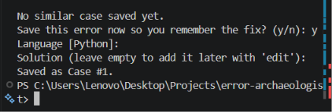

# Error Archaeologist



> remember how you fixed it

A local, offline debugging memory. Save an error together with the fix that
worked, then find it again the next time the same bug shows up, even if the
file paths, line numbers and variable names are different.

No dependencies. Python 3.9+ only.

## Try it in 30 seconds

[](https://codespaces.new/RehabTariqq/error-archaeologist)

Click the button and wait about a minute for the terminal to load. It comes with 8 sample cases already saved. Then try:

```bash
python main.py search "TypeError: Cannot read properties of undefined (reading 'filter')"
python main.py search "No module named 'flask'"
python main.py list --language python
python main.py stats
```

Or run it on your own computer:

```bash
git clone https://github.com/RehabTariqq/error-archaeologist.git
cd error-archaeologist
python main.py import examples/sample_cases.json
python main.py search "NameError: name 'x' is not defined"
```
## Features

- Save, view, edit and delete debugging cases (stored in `data/cases.json`)
- Smart search: rare words rank higher, typos are tolerated, and errors are
  matched after removing paths, line numbers and variable names
- `run` command: execute any command, and if it fails, instantly see similar
  cases you have already solved
- Filter by language, category or tag
- Statistics, Markdown/JSON export, JSON import
- Safe storage: atomic writes and automatic backup of a corrupt data file

## Quick start

```bash
python main.py            # interactive menu
python main.py --help     # all commands
```

### Install as a command

```bash
pip install .
ea --help
```

After installing, `ea` and `error-archaeologist` work from any folder.

## Commands

```bash
python main.py add --language Python --error "KeyError: 'id'" \
    --solution "Use dict.get('id')" --category Runtime --tags dict,keys
python main.py list --language python
python main.py search "NameError: name 'total' is not defined"
python main.py show 3
python main.py edit 3
python main.py delete 3 --yes
python main.py stats
python main.py export --format markdown --output cases.md
python main.py import cases.json
python main.py run -- python my_script.py
python main.py search --clip     # search the error you just copied
```

### Search the clipboard

Copy an error or a full traceback, then run `python main.py search --clip`.
For a traceback, the last error line is used.

### The `run` command

```bash
python main.py run -- python broken.py
```

If `broken.py` crashes, Error Archaeologist reads the error, searches your
saved cases and prints the closest matches. If nothing matches, it offers to
save the new error so you can add the fix later with `edit`.

## How search works

1. Text is tokenised (`C++`, `C#` and `node.js` survive intact).
2. Each match is weighted by field (error 5, solution 3, tags 2, ...) and by
   rarity (IDF), so uncommon words matter more than common ones.
3. Near-miss words (typos) get partial credit.
4. The error message is normalised (`'x'` becomes `<name>`, paths become
   `<path>`, numbers become `<n>`) and compared with a similarity ratio.
5. Matching exception classes (`TypeError` = `TypeError`) earn a bonus.

## Project layout

```
main.py                    entry point
error_archaeologist/
    storage.py             JSON storage, CRUD, atomic writes
    normalize.py           error normalisation and tokenising
    search.py              ranking
    exporter.py            Markdown/JSON export, import parsing
    clipboard.py           read the system clipboard
    cli.py                 commands and interactive menu
docs/shell-integration.md  PowerShell and Bash helpers
pyproject.toml             packaging (pip install .)
tests/                     unit tests
```

## Tests

```bash
python -m unittest -v
```

## Data location

- Source checkout: `data/cases.json` next to the project.
- After `pip install`: your user data folder (`%APPDATA%\error-archaeologist`
  on Windows, `~/.local/share/error-archaeologist` on Linux/macOS).
- Override either with the `ERROR_ARCHAEOLOGIST_DATA` environment variable.

See [docs/shell-integration.md](docs/shell-integration.md) for shell helpers.
